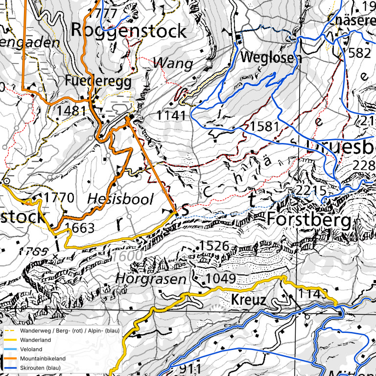
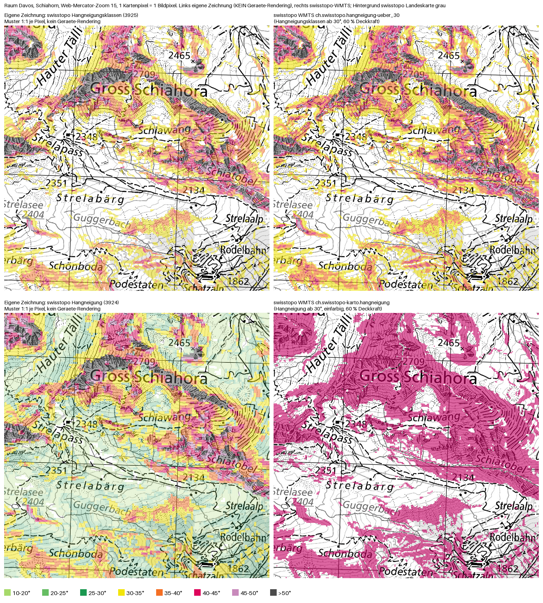

# swisstopo → Garmin: SwissTOPO Vector, Höhenlinien und Routen-Overlays

Dieses Repo baut aus offenen Bundesdaten Vektorkarten für Garmin-Geräte (`.img`):

- **SwissTOPO Vector Edge / Fenix** (`swisstopo_vector_edge_schweiz.img`, `swisstopo_vector_fenix_schweiz.img`): die Basiskarten der ganzen Schweiz aus swissTLM3D, zwei Varianten (Edge mit mehr Namen, Grenzen und Schildern; Fenix reduziert).
- **Höhenlinien** (10 m und 20 m) und **Routen-Overlays** (Wanderwege, Wanderland, Veloland, Mountainbikeland, Skirouten): je eine **eigene Karte** mit eigener Family-ID, die auf eine Basiskarte gelegt wird (SwissTOPO Vector, die Garmin-Karte oder OpenTopoMap).
- **Hangneigung** und **Hangneigungsklassen** (ab 30°, wie swisstopo «Hangneigung über 30°»): zwei semitransparente Flächen-Overlays aus swissALTIRegio (10 m), siehe Abschnitt [Hangneigungs-Overlays](#hangneigungs-overlays).

**Teststand:**
- **Garmin Edge 1040: geprüft, funktioniert.** Der Nutzer hat Overlays für Skirouten, Wanderwege und Fahrradrouten aufs Gerät geladen. Mehrere `.img`-Dateien nebeneinander werden also geladen. Welche der beiden Fahrradkarten (Veloland, Mountainbike) einzeln geprüft wurde, ist nicht festgehalten.
- **Garmin Fenix 5S Plus: Test offen.** Ob die Uhr mehrere `.img` nebeneinander lädt und wie die Linien auf dem kleinen Display aussehen, ist ungeprüft.

Die Overlays:

| Datei | Inhalt | Darstellung |
|---|---|---|
| `swisstopo_overlay_wanderwege.img` | Wanderwegnetz der Schweiz (swissTLM3D, Stand 2026-07) | schwarz, nicht farbig codiert; Linienart nach Wegtyp wie in der swisstopo-Zeichenerklärung (2-m-Weg durchgezogen, 1-m-Weg gestrichelt, markierte Spur punktiert) |
| `swisstopo_overlay_wanderland.img` | Wanderland-Routen (SchweizMobil) | gelb |
| `swisstopo_overlay_veloland.img` | Veloland-Routen (SchweizMobil) | hellblau |
| `swisstopo_overlay_mountainbike.img` | Mountainbikeland-Routen (SchweizMobil) | orange |
| `swisstopo_overlay_skirouten_blau.img` | Skirouten (swisstopo/SAC u. a.) | blau, durchgezogen, weisser Rand (wie auf der Rasterkarte) |
| `swisstopo_overlay_skirouten_schwierigkeit.img` | gleiche Skirouten | gestrichelt, nach SAC-Schwierigkeit: grün L, blau WS, orange ZS, rot S, violett unbekannt |
| `swisstopo_overlay_skilifte.img` | Bahnen, die im Winter fahren (`ch.swisstopo.bahnen-winter`, wie Landeskarte Winter): Skilifte, Sessel-, Gondel-, Luftseil-, Standseilbahnen | wie Landeskarte Winter: Skilift ocker-orange mit Querstrichen, Sessel-/Gondelbahn dunkelrot mit Kreisen (Masten, in festem Abstand), Luftseilbahn dunkelrot 3 px, Standseilbahn rote Doppellinie mit Sprossen; Name erst in den feinen Zoomstufen |
| `swisstopo_overlay_unterkuenfte_winter.img` | Unterkünfte Winter (`ch.swisstopo.unterkuenfte-winter`, swisstopo/SAC), ergänzt um Hütten aus swissNAMES3D | roter Ring (13 px, `#FF1900`, innen leer, weisser Rand) wie im swisstopo-Viewer, schon weit herausgezoomt, Name mit Höhe ab mittlerer Zoomstufe («Kesch-Hütte SAC 2623»); nur in der feinsten Stufe zusätzlich kleine Häuser: braun = SAC-Hütte ausserhalb des Winter-Datensatzes, grau = übrige Hütte |
| `swisstopo_overlay_schneeschuhrouten.img` | Schneeschuhrouten (`ch.swisstopo-karto.schneeschuhrouten`, swisstopo/SAC und Winterwanderwege VS) | türkisgrün `#008A79`, durchgezogen, weisser Rand (wie swisstopo); Name mit WT-Schwierigkeit in der feinsten Stufe |
| `swisstopo_overlay_skipisten.img` | **OpenStreetMap** (nicht swisstopo): Pisten `piste:type=downhill` (9'158 Linien, 919 Flächen), Langlauf `nordic` (5'348), Skitouren `skitour` (525), Schlitteln `sled` (610); Auszug OpenStreetMap France vom 2026-11-11 | Abfahrt blau (novice/easy), rot (intermediate), schwarz (advanced/expert), orange gestrichelt (freeride/extreme), grau (unbekannt); 3 px mit 1 px weissem Rand; Langlauf grün gestrichelt, Skitour violett gepunktet, Schlitteln braun gestrichelt; Pistenflächen halbdurchsichtig (Schachbrett) mit 1-px-Umriss; Name ab der feinen Zoomstufe; Menü «OSM Skipisten» |
| `swisstopo_overlay_hoehenlinien.img` | Höhenlinien, Äquidistanz 20 m (swissALTI3D 2 m) | hellbraun; alle 100 m dunkler und stärker, mit Höhenangabe |
| `swisstopo_overlay_hangneigung.img` | Hangneigung in 8 Stufen ab 10° (swissALTIRegio 10 m, Klassen auf 20-m-Raster) | semitransparent (Punktmuster): 10–20° hellgrün, 20–25° grün, 25–30° dunkelgrün (je 25 % der Pixel), ab 30° wie die Klassen-Karte (50 %); unter 10° leer |
| `swisstopo_overlay_hangneigungsklassen.img` | Lawinen-Hangneigungsklassen ab 30° wie `ch.swisstopo.hangneigung-ueber_30` (10-m-Raster) | semitransparent (Schachbrett, 50 % der Pixel): 30–35° gelb `#F2E50A`, 35–40° orange `#F46F24`, 40–45° rot `#DE055B`, 45–50° violett `#C889BB`, über 50° grau `#4B4B4B` (Farben an der WMTS-Ebene gemessen) |

Die Routen von SchweizMobil tragen «Nummer Name» als Beschriftung (z. B. «1 Via Alpina»), die Skirouten «Name Schwierigkeit». Bei Wanderland, Veloland und Mountainbikeland sind die Linien nach national (breit), regional und lokal gestuft.

Fertige Dateien liegen im Ordner `karten/` (siehe unten).



*Vorschau: eigene Zeichnung mit denselben Farben über einer grauen Landeskarte, kein Rendering vom Gerät.*

## Fertige Karten (`karten/`)

| Ordner | Inhalt | Grösse |
|---|---|---|
| `karten/overlay_hoehenlinien_schweiz/` | Höhenlinien 10 m und 20 m, ganze Schweiz, je in 2 Teilen (zusammensetzen mit `cat`, siehe README im Ordner) | 168 MB und 109 MB |
| `karten/swisstopo_vector_edge_schweiz/` | **SwissTOPO Vector Edge**, ganze Schweiz, in 3 Teilen (zusammensetzen mit `cat`, siehe README im Ordner) | 241 MB |
| `karten/swisstopo_vector_fenix_schweiz/` | **SwissTOPO Vector Fenix**, ganze Schweiz, in 3 Teilen | 225 MB |
| `karten/overlays_schweiz/` | alle Overlays einzeln, ganze Schweiz (Routen, Haltestellen, Winter, Skipisten, Hangneigung) | 137 MB, davon Hangneigung 75 MB und Hangneigungsklassen 45 MB |
| `karten/overlays_oberiberg_test/` | alle 6 Overlays, Testausschnitt Oberiberg SZ (ca. 40 × 40 km) plus `vorschau.png` | 0,8 MB |

Installation: gewünschte `.img` nach `Garmin/` auf das Gerät kopieren (USB), neu starten, unter Einstellungen → Karte aktivieren. Eine vorhandene `gmapsupp.img` nicht überschreiben.

## Datenquellen

Alle Daten ausser den Skipisten (OpenStreetMap, siehe Tabelle) sind offen auf `data.geo.admin.ch` verfügbar (STAC-Collection in Klammern). Die Lizenz steht dort als «proprietary»; die Nutzungsbedingungen von swisstopo bzw. ASTRA/SchweizMobil gelten. Repo daher nicht öffentlich machen, ohne sie geprüft zu haben.

| Ebene | Datensatz | Stand |
|---|---|---|
| Wanderwege | swissTLM3D Wanderwege, Layer `tlm_strassen_strasse` mit Feld `wanderwege` (`ch.swisstopo.swisstlm3d-wanderwege`), 409'276 Abschnitte | 2026-07 |
| Wanderland, Veloland, Mountainbikeland | SchweizMobil, Layer `Route` (`ch.astra.wanderland`, `ch.astra.veloland`, `ch.astra.mountainbikeland`) | 2026-02 |
| Skirouten | `ch.swisstopo-karto.skitouren`, 10'789 Routen: swisstopo/SAC 9'384, Petzl Foundation/Skitourenguru 884, DAV/ÖAV/AVS 439, topo.verlag 82 (Feld `source`) | 2025-12 |
| SwissTOPO Vector | swissTLM3D (`ch.swisstopo.swisstlm3d`), Ausgabe 2026-02 | 2026-02 |
| Skilifte | Bahnen Winter (`ch.swisstopo.bahnen-winter`, swisstopo/SAC, jährlich nachgeführt, in der Schweiz eine Auswahl aus swissTLM3D), 1'805 Bahnen: 840 Skilifte, 361 Sesselbahnen, 137 Gondelbahnen, 193 Luftseilbahnen, 251 Standseilbahnen, 23 andere; inkl. grenznaher Gebiete im Ausland | 2025-11-20 |
| Unterkünfte Winter | `ch.swisstopo.unterkuenfte-winter` (swisstopo/SAC), alle 506 Unterkünfte als roter Ring; dazu aus swissNAMES3D 2026 (`ch.swisstopo.swissnames3d`, Gebäudenamen) 27 SAC-Hütten, die nicht im Winter-Datensatz stehen (Name enthält «SAC» oder «CAS»; ein Eigentümer-Attribut gibt es nicht), und 987 übrige Hütten (Schutzhütten, andere Clubhütten, Biwaks, Name mit Hütte, Cabane, Refuge, Capanna, Berghaus …; ohne Forst-/Waldhütten); Punkte unter 250 m neben einem Punkt mit Vorrang weggelassen | 2025-11-20 / 2026 |
| Schneeschuhrouten | `ch.swisstopo-karto.schneeschuhrouten`, Datei `snowshoe_routes_2056.gpkg`, 2'825 Routen (4'630 km): swisstopo/SAC 2'485, Winterwanderwege Kt. VS 340; 292 mit Name und WT-Schwierigkeit | 2025-12-11 |
| Skipisten | **OpenStreetMap** (Auszug OpenStreetMap France, `https://download.openstreetmap.fr/extracts/europe/switzerland-latest.osm.pbf`, 684 MB, Stand 2026-11-11), Tags `piste:type`, `piste:difficulty`, `piste:name`; Geofabrik war von der Cloud-Umgebung aus nicht erreichbar. **Lizenz ODbL, © OpenStreetMap-Mitwirkende** (<https://www.openstreetmap.org/copyright>); die Namensnennung steht auch in der Karte (`--copyright-message`). Der Auszug ist an der Landesgrenze beschnitten, grenznahe Pisten im Ausland fehlen | 2026-11-11 |
| Höhenlinien | swissALTI3D (`ch.swisstopo.swissalti3d`), 2-m-Raster, neuestes Jahr je 1-km-Kachel | 2019–2026 |
| Hangneigung | swissALTIRegio (`ch.swisstopo.swissaltiregio`), 10-m-Raster, eine Cloud-Optimized-GeoTIFF-Datei (10 GB, es werden nur die Ausschnitte gelesen); begrenzt auf Schweiz + Liechtenstein + 1 km aus swissBOUNDARIES3D (`ch.swisstopo.swissboundaries3d`, Layer `tlm_landesgebiet`) | 2026-05 / 2026-01 |

## Aufbau des Repos

```
README.md                      diese Datei
AGENTS.md                      Kontext für KI-Assistenten (Ziel, Entscheide, Stand)
scripts/                       alle Skripte
  download_daten.sh              lädt die Overlay-Datensätze von data.geo.admin.ch
  build_overlays.sh              baut die 6 Overlay-.img (Hauptskript, siehe unten)
  routes2mkgmap.py                  GeoPackage → OSM-XML für die Routen-Overlays
  make_overlay_typ.py            schreibt die TYP-Dateien (Farben, Breiten, Muster)
  mkgmap_xml_writer.py                  gemeinsame OSM-XML-Ausgabe
  build_skilifte.sh              baut das Skilifte-Overlay (skilifte2mkgmap.py, make_skilifte_typ.py)
  build_unterkuenfte_winter.sh   baut das Overlay Unterkünfte Winter (unterkuenfte2mkgmap.py, make_unterkuenfte_typ.py)
  build_schneeschuhrouten.sh     baut das Schneeschuhrouten-Overlay (routes2mkgmap.py --kind schneeschuh, make_schneeschuh_typ.py)
  build_skipisten.sh             baut das Skipisten-Overlay aus OpenStreetMap (skipisten2mkgmap.py, make_skipisten_typ.py; braucht pyosmium)
  build_hoehenlinien.sh          baut das Höhenlinien-Overlays (10 m und 20 m) aus swissALTI3D
  hoehenlinien2mkgmap.py            swissALTI3D-Kacheln → Höhenlinien als OSM-XML
  swissalti3d_kachelliste.py     listet alle swissALTI3D-Kacheln (neuestes Jahr)
  build_hangneigung.sh           baut die Overlays Hangneigung und Hangneigungsklassen aus swissALTIRegio
  hangneigung2mkgmap.py             Höhenmodell → Neigung → Klassenflächen als OSM-XML
  make_hangneigung_typ.py        schreibt die beiden TYP-Dateien (Farben, Punktmuster)
  preview_hangneigung.py         Vergleichszeichnung gegen die swisstopo-WMTS-Ebenen
  build_vector.sh                baut SwissTOPO Vector (ganze Schweiz oder Region)
  vector2mkgmap.py                  swissTLM3D-Shapefiles → OSM-XML, inkl. abgeleitetem Siedlungsgebiet
  make_vector_typ.py             schreibt die TYP-Datei (Farben, Muster, Linien)
  vector_palette.py              Farben von SwissTOPO Vector (aus Edge-1040-Bildschirmfotos)
  preview_vector.py              Vorschau-Zeichnung von SwissTOPO Vector
mkgmap/
  overlays/style/                mkgmap-Regeln: Tags → Garmin-Linientypen
  overlays/typ/                  erzeugte TYP-Dateien, eine je Overlay
  vector/style/, typ/            dasselbe für SwissTOPO Vector
karten/                        fertige Karten
experimente/                   Einzelversuche, nicht Teil der Pipeline
```

## Eigene Karten bauen

### Voraussetzungen
- Python 3 mit `pyogrio shapely pyproj numpy` (für die Vorschau zusätzlich `geopandas matplotlib`), z. B. `python3 -m venv venv && venv/bin/pip install pyogrio shapely pyproj numpy geopandas matplotlib`
- Java (getestet mit 21) und **mkgmap** (getestet r4924): <https://www.mkgmap.org.uk/download/mkgmap.html>
- Rund 1 GB Festplatte für die Daten, 15 GB RAM sind komfortabel (die Schweiz wird in 4 Kacheln gebaut)
- Internetzugang zu `data.geo.admin.ch`

### Schritte
```
scripts/download_daten.sh daten/                       # einmalig, ca. 750 MB
scripts/build_overlays.sh daten/ mkgmap/mkgmap.jar out/                      # ganze Schweiz
scripts/build_overlays.sh daten/ mkgmap/mkgmap.jar out/ 8.50 46.85 9.05 47.21   # nur eine Region (W S E N)
```
Ergebnis: `out/swisstopo_overlay_*.img`. Die ganze Schweiz braucht einige Minuten. Bereits berechnete Zwischenstände (`out/osm/`) werden wiederverwendet; zum Neuberechnen löschen.

### Was `build_overlays.sh` tut
Das Skript baut aus den GeoPackages die sechs `.img`-Dateien:

1. **Kacheln festlegen.** Mit Bounding Box eine Kachel, sonst die Schweiz in 2 × 2 Kacheln, damit der Speicher reicht.
2. **Konvertieren** (`routes2mkgmap.py`). Liest je Ebene das GeoPackage, schneidet die Linien auf die Kachel zu, vereinfacht sie (2 m) und schreibt OSM-XML mit den Tags `route_layer` (wanderwege, wanderland, veloland, mtb, ski), `route_class` (z. B. national/regional/lokal, Wanderweg/Berg/Alpin, SAC-Klasse 1–4) und `name`. Hin- und Rückweg identischer SchweizMobil-Routen werden nur einmal geschrieben.
3. **TYP-Dateien schreiben** (`make_overlay_typ.py`). Pro Overlay eine TYP-Datei mit eigener Family-ID: Farben, Linienbreiten, Strichmuster.
4. **mkgmap aufrufen**, einmal je Overlay. mkgmap liest die OSM-Dateien, ordnet über `mkgmap/overlays/style/lines` jedem Tag-Satz einen Garmin-Linientyp zu und verpackt alles mit der TYP-Datei in eine `gmapsupp.img`. Der Name im Gerätemenü kommt aus `--description`.
5. **Umbenennen** nach `swisstopo_overlay_<name>.img` im Ausgabeordner.

| Overlay | Family-ID | Mapname (64 + Family-ID + laufende Nr.) |
|---|---|---|
| Wanderwege | 3911 | 64391101 bis 64391104 (4 Kacheln) |
| Wanderland | 3912 | 643912xx |
| Veloland | 3913 | 643913xx |
| Mountainbikeland | 3914 | 643914xx |
| Skirouten blau | 3915 | 643915xx |
| Skirouten nach Schwierigkeit | 3916 | 643916xx |
| Haltestellen | 3918 | 64391801 |
| Skilifte (`scripts/build_skilifte.sh`) | 3921 | 64392101 |
| Unterkünfte Winter (`scripts/build_unterkuenfte_winter.sh`) | 3922 | 64392201 |
| Schneeschuhrouten (`scripts/build_schneeschuhrouten.sh`) | 3923 | 64392301 |
| Skipisten (`scripts/build_skipisten.sh`, OSM) | 3926 | 64392601 |
| Hangneigung (`scripts/build_hangneigung.sh`) | 3924 | 64392401 bis 64392444 (44 Blöcke à 40 km) |
| Hangneigungsklassen (`scripts/build_hangneigung.sh`) | 3925 | 64392501 bis 64392544 |

### Aussehen anpassen
- **Farben, Breiten, Strichmuster:** `scripts/make_overlay_typ.py` (Konstanten oben: `YELLOW`, `LBLUE`, `ORANGE`, `SKI_BLUE`, Breiten je Kategorie). Danach `build_overlays.sh` neu starten; die OSM-Zwischendateien werden wiederverwendet.
- **Zuordnung Kategorie → Linientyp:** `mkgmap/overlays/style/lines`.
- **Ab welchem Zoom sichtbar:** `resolution`-Werte in `mkgmap/overlays/style/lines` (höher = erst bei stärkerer Vergrösserung).

### Technische Fallstricke (mkgmap)
- `--style-file` zeigt direkt auf das Style-Verzeichnis. Mit zusätzlichem `--style=.` nutzt mkgmap still den Standard-Style und ignoriert die eigenen Tags.
- Erweiterte Linientypen: Code `0x10f00`–`0x10f1f` (Subtyp höchstens `0x1f`), Skirouten `0x11000`–`0x11004`.
- Die TYP-Compiler-Fehler sind stumm (nur `MapFailedExceptions: 1`). Muster-Linien brauchen Breite 32 (`Xpm="32 H N 1"`), und die durchsichtige Farbe (`none`) muss in der Farbtabelle **zuerst** stehen.
- `--mapname` hat 8 Ziffern und muss über **alle** geladenen `.img`-Dateien eindeutig sein. Schema: Vektorkarten `6390NNNN` (Edge) und `6391NNNN` (Fenix), Höhenlinien `6392NNNN` (20 m) und `6393NNNN` (10 m), mit NNNN = i*100+j der 20-km-Kachel. Overlays: `64` + Family-ID (4 Ziffern) + laufende Nummer (2 Ziffern, 01..99), z. B. Wanderwege `64391101`–`64391104`. Das Präfix 64 kann nie mit 6390–6393 kollidieren (frühere Overlay-Nummern wie `63911001` kollidierten mit Fenix-Kacheln).
- Polygone erscheinen nur, wenn sie im TYP unter `[_drawOrder]` stehen (relevant für SwissTOPO Vector).

## Höhenlinien-Overlay (`swisstopo_overlay_hoehenlinien.img`)
`scripts/build_hoehenlinien.sh` berechnet aus swissALTI3D (2 m Raster) Höhenlinien mit **20 m Äquidistanz** für die ganze Schweiz (109 MB, Family-ID 3917). Jede 50 m eine Zwischenlinie, jede 100 m eine Hauptlinie, beide mit Höhenangabe. Es ist ein Overlay: es lässt sich über die Basiskarte und die Routen-Overlays legen. Auf keinem Gerät geprüft.
```
scripts/swissalti3d_kachelliste.py tiles_2m.json                  # einmalig, 15–20 Minuten
scripts/build_hoehenlinien.sh tiles_2m.json mkgmap.jar out/                     # ganze Schweiz
scripts/build_hoehenlinien.sh tiles_2m.json mkgmap.jar out/ 8.24 47.44 8.38 47.51   # Region
```
Ablauf: 20-km-Blöcke im LV95-Raster → je Block parallel (3 Prozesse) die 1-km-Kacheln laden (ca. 1 MB je Kachel, die ganze Schweiz sind rund 45 GB Download, nichts davon wird gespeichert), mit `contourpy` Linien im Abstand von 10 m berechnen, mit 2,5 m vereinfachen, als OSM-XML schreiben, mit mkgmap zur Block-Karte bauen, am Ende alle Blöcke und die TYP-Datei zusammenführen. Dauer für die ganze Schweiz: etwa 40 Minuten. Fortsetzbar. Die Linien liegen im Typ `0x20` (10 m), `0x21` (50 m), `0x22` (100 m); Farben und Breiten stehen in `scripts/make_overlay_typ.py`, Sichtbarkeit je Zoom in `mkgmap/overlays/style/lines`.

## Skipisten-Overlay (OpenStreetMap)
`swisstopo_overlay_skipisten.img` (Family-ID 3926, Kartennummer 64392601, Menü «OSM Skipisten», 1,3 MB) ist die **einzige Karte im Repo aus OpenStreetMap**, auf ausdrücklichen Wunsch des Nutzers; alle übrigen Daten stammen von swisstopo/ASTRA. Daten © OpenStreetMap-Mitwirkende, ODbL: die Karte enthält den Hinweis, bei Weitergabe die Namensnennung beibehalten.
```
scripts/build_skipisten.sh switzerland-latest.osm.pbf mkgmap.jar out/                        # ganze Schweiz, ca. 3 Minuten
scripts/build_skipisten.sh switzerland-latest.osm.pbf mkgmap.jar out/ 9.75 46.75 9.95 46.90   # Region
```
- **Ablauf:** `skipisten2mkgmap.py` liest den Auszug mit pyosmium (Relationen, Wege, Knoten in drei Durchgängen), baut Linien und Flächen (Multipolygone mit shapely) und schreibt OSM-XML mit `piste_layer` (downhill, nordic, skitour, sled), `piste_class` (blue, red, black, orange, grey) und `name` (`piste:name`, sonst `name`, `piste:ref`, `ref`); danach mkgmap und TYP (`make_skipisten_typ.py`).
- **Zählung (Stand 2026-11-11):** Abfahrt 10'077 Objekte (Linien 9'158, Flächen 919): easy 4'636, intermediate 3'739, advanced 930, freeride 339, novice 273, expert 20, ohne Angabe 137 (der Rest sind Tippfehler wie «eaasy» und «difficult», grau). Langlauf 5'348 (easy 3'052, intermediate 1'149, novice 510, advanced 213, ohne Angabe 421), Skitour 525, Schlitteln 610. Skitour und Schlitteln tragen oft kein `piste:difficulty`.
- **Farben** (europäische Konvention, nach `piste:difficulty`): novice/easy blau `#0B5CD6`, intermediate rot `#E01B1B`, advanced/expert schwarz, freeride/extreme orange `#FF8A00` gestrichelt, unbekannt grau. Linien 3 px mit 1 px weissem Rand. Flächen (nur Abfahrt): Schachbrett aus Farbe und `none` plus 1-px-Umriss; die Schwierigkeit gilt für die ganze Fläche.
- **Typen und Zoom:** erweiterte Linientypen `0x10f00`–`0x10f0c`, Flächentypen `0x10e00`–`0x10e04` (in keiner anderen TYP-Datei belegt). Linien ab Auflösung 20, Flächen ab 20, Umrisse ab 21, Namen ab 22. Draw-Priority 30.
- **Grenzen:** der OSM-France-Auszug ist an der Landesgrenze beschnitten (Koordinatenbereich 6,04–10,52 E, 45,87–47,79 N); Pisten jenseits (z. B. Portes du Soleil auf französischer Seite) fehlen. Pisten sind in OSM unterschiedlich gut gepflegt; offene, nicht präparierte Pisten und Freeride-Linien sind keine Sicherheitsangabe. **Auf keinem Gerät geprüft** (Darstellung der Muster mit `none`, Lesbarkeit, Namen).

## Hangneigungs-Overlays
Zwei Flächen-Overlays aus derselben Neigungsberechnung, je eine eigene Karte (auf keinem Gerät geprüft):

| Datei | Gerätemenü | Family-ID | Inhalt | Raster | Grösse |
|---|---|---|---|---|---|
| `swisstopo_overlay_hangneigung.img` | «swisstopo Hangneigung» | 3924 | 10–20, 20–25, 25–30, 30–35, 35–40, 40–45, 45–50, > 50° (unter 10° leer) | 20 m | 75 MB |
| `swisstopo_overlay_hangneigungsklassen.img` | «swisstopo Hangneigungsklassen» | 3925 | nur die Lawinenklassen 30–35, 35–40, 40–45, 45–50, > 50° | 10 m | 45 MB |

```
scripts/build_hangneigung.sh swissBOUNDARIES3D_1_5_LV95_LN02.gpkg mkgmap.jar out/                        # ganze Schweiz
scripts/build_hangneigung.sh swissBOUNDARIES3D_1_5_LV95_LN02.gpkg mkgmap.jar out/ 9.75 46.75 9.95 46.90   # Region
```
- **Daten:** swissALTIRegio (10 m) statt swissALTI3D: swisstopo bietet die Neigung nicht als Datensatz an (im STAC gibt es keine Collection dazu, nur die WMTS-Ebenen), und swissALTI3D gibt es nur in 0,5 m und 2 m (45 GB Download für die Schweiz). swissALTIRegio ist ein einziges Cloud-Optimized GeoTIFF; das Skript liest nur die Blockausschnitte (rund 3 GB Download für die Schweiz, nichts wird gespeichert). Die swisstopo-Ebenen «Hangneigung ab 30°» sind laut Beschreibung ebenfalls aus einem 10-m-Modell abgeleitet.
- **Neigung:** Horn-Verfahren (3 × 3 Zellen, wie `gdaldem slope`) auf 10 m. Abgleich mit der WMTS-Ebene `ch.swisstopo.hangneigung-ueber_30` (Raum Davos, Zoom 14, 262'000 Pixel, davon 93'600 farbig): bei 99,9 % der Pixel fällt die eigene Neigung in dieselbe Klasse wie bei swisstopo (Median gelb 32,5°, orange 37,2°, rot 41,6°, violett 46,7°, grau 52,2°); swisstopo rechnet also offenbar gleich. Daraus auch: swisstopo hat eine fünfte Klasse **über 50° (grau `#4B4B4B`)**.
- **Flächen:** Klassenraster → Flecken unter 400 m² gehen in der Nachbarklasse auf (`rasterio.features.sieve`) → Polygone (`rasterio.features.shapes`) → gemeinsam vereinfacht als Flächendeckung (`shapely.coverage_simplify`, 0,6 × Rasterweite, Nachbarflächen behalten die gemeinsame Kante) → exakt am Blockrand zugeschnitten. Die Karte Hangneigung nutzt das Mittel von 2 × 2 Zellen (20 m), weil sie mit 10 m hochgerechnet rund 100 MB gross würde (Testregion Davos: 0,85 statt 0,65 MB) und für die Übersicht unter 30° kein 10-m-Detail braucht; die Klassen-Karte bleibt bei 10 m.
- **Dauer und Bedarf:** ganze Schweiz rund 26 Minuten (4 Kerne, `JOBS=3`, je Block bis etwa 3 GB RAM und bis 1,3 GB OSM-Zwischendatei, die gleich wieder gelöscht wird). Python braucht zusätzlich `rasterio` (`venv/bin/pip install rasterio`).
- **Blöcke:** 40 × 40 km im LV95-Raster (Ursprung 2480000/1070000, also je 2 × 2 der 20-km-Kacheln der anderen Karten), 44 Blöcke. Grund: das Nummernschema `64<FamilyID>NN` erlaubt höchstens 99 Kacheln, mit 20 km wären es 148.
- **Semitransparent:** Garmin-TYP kennt kein Alpha. Jede Klasse ist ein 32 × 32-Muster aus einer Farbe und `none` (durchsichtig): ab 30° Schachbrett (50 % der Pixel farbig), unter 30° jeder zweite Pixel jeder zweiten Zeile (25 %). Ein Dichtetest (eigene Zeichnung) zeigte: 25 % ist für die Lawinenklassen zu blass (gelb verschwindet fast), 50 % für die grossen Flächen unter 30° zu deckend. Dichte änderbar mit `scripts/make_hangneigung_typ.py --dichte 50|25 --dichte-flach 50|25`.
- **Typen und Zoom:** erweiterte Flächentypen `0x10e0d`–`0x10e0f` (unter 30°) und `0x10e1b`–`0x10e1f` (ab 30°), in keiner anderen TYP-Datei des Repos belegt; Standardtypen vermieden, weil ein Kartenthema sie umfärben kann. Sichtbar ab Auflösung 20 (`mkgmap/hangneigung/style/polygons`), Ebenen `0:22, 1:20` (die feinste Ebene 22 statt 24 halbiert die Dateigrösse, die Koordinaten sind dann auf rund 5–10 m gerundet, passend zum 10-m-Raster). `--draw-priority=26`: über SwissTOPO Vector (20), unter den Linien-Overlays (30).
- Die Neigung ist eine Planungshilfe; sie ersetzt weder Lawinenbulletin noch Beurteilung vor Ort. Nahe der Landesgrenze stammt swissALTIRegio aus den Modellen der Nachbarländer (Genauigkeit laut swisstopo dort nicht garantiert).



*Raum Davos, Schiahorn (Zoom 15): links eigene Zeichnung der beiden Overlays mit den TYP-Mustern 1:1 über der grauen Landeskarte, rechts die swisstopo-WMTS-Ebenen. Eigene Zeichnung, kein Rendering vom Gerät.*

## SwissTOPO Vector, zwei Varianten (Family-ID 3900 und 3901)
Vektorkarten der ganzen Schweiz aus swissTLM3D (Stand 2026-02), je eine Datei in drei Teilen wegen der GitHub-Grenze von 100 MB. Die Darstellung ist an Bildschirmfotos der Garmin-Vektorkarte auf dem Edge 1040 gemessen; die Flächenmuster für Fels und Reben sind aus diesen Fotos ausgelesen (`scripts/extract_pattern.py`, persönlicher Gebrauch, das Repo ist privat). **Auf keinem Gerät geprüft** (der Nutzer hat nur eine frühere Fassung auf dem Edge 1040 gesehen, sie lud).

| | **SwissTOPO Vector Edge** (3900) | **SwissTOPO Vector Fenix** (3901) |
|---|---|---|
| Ordner | `karten/swisstopo_vector_edge_schweiz/` (241 MB) | `karten/swisstopo_vector_fenix_schweiz/` (225 MB) |
| Fels | graue Fläche mit Textur | einfach grau |
| Namen | Orts-, Strassen-, Gewässer-, Flur-, Geländenamen, Berge mit Höhe («Säntis 2502») | nur die Höhe an Gipfeln und Pässen |
| Grenzen (swissBOUNDARIES3D) | Landes-, Kantons-, Gemeindegrenzen, magenta | keine |
| Strassenschilder (ASTRA) | Nationalstrassen N1 … N29 und 56 Hauptstrassennummern | keine |
| Sportplätze, Freizeitflächen | ja (Sportplätze orange) | nein |

Gemeinsam: Einzelbäume, Schutzverbauungen und Treppen (rot gepunktet) nur in der feinsten Zoomstufe; Reben (orange Blitzstriche auf hellgrün); Tunnel als zwei graue Punktreihen an den Rändern (wie auf der Garmin-Karte); Brücken als Strasse mit schwarzem Rand; Wege 2 px in Dunkelgrau `#414041` nach swisstopo-Legende (2-m-Weg durchgezogen, 1-m-Weg gestrichelt, markierte Spur punktiert); Schutzverbauungen braun, 2 px.

| Element | Darstellung |
|---|---|
| Untergrund | creme `#FFFAE6` |
| Siedlungsgebiet | hellgrau `#EEEEEE`, **abgeleitet** aus den Gebäuden (jedes Gebäude 14 m vergrössert, vereinigt, Gruppen unter 8'000 m² verworfen) |
| Gebäude | grau `#8B898B` |
| Wald / Gehölz | grün `#A4D26A` / hellgrünes Punktmuster |
| Gewässer | See hellblau, Bäche und Flüsse `#52BAF6` |
| Strassen | Autobahn orange, Hauptstrasse gelb, übrige weiss mit grauem Rand, Naturstrassen hellgelb |

Skilifte, Unterkünfte Winter und Schneeschuhrouten sind ebenfalls eigene Layer (`karten/overlays_schweiz/`, Family-ID 3921, 3922 und 3923, auf keinem Gerät geprüft):
```
scripts/build_skilifte.sh daten/bahnen-winter_2056.gpkg mkgmap.jar out/ [W S E N]
scripts/build_unterkuenfte_winter.sh daten/unterkuenfte-winter_2056.gpkg daten/swissnames3d_2026_2056.gpkg mkgmap.jar out/ [W S E N]
scripts/build_schneeschuhrouten.sh daten/snowshoe_routes_2056.gpkg mkgmap.jar out/ [W S E N]
```

Haltestellen sind **nicht** in der Basiskarte, sondern ein eigener Layer: `karten/overlays_schweiz/swisstopo_overlay_haltestellen.img` (Family-ID 3918, 28'042 Haltestellen aus swissTLM3D mit Namen und Symbolen für Bus, Bahn, Schiff, übrige Bahnen). Gebaut mit `scripts/build_haltestellen.sh <shp-ordner> mkgmap.jar out/`.

```
# ganze Schweiz, Edge (Grenzen und Schilder brauchen die Zusatzdaten, siehe unten)
VARIANT=edge GRENZEN=<gpkg> ACHSEN=<gdb> HAUPT=<gdb> scripts/build_vector.sh <shp-ordner> mkgmap.jar out/
VARIANT=fenix scripts/build_vector.sh <shp-ordner> mkgmap.jar out/
scripts/build_vector.sh <shp-ordner> mkgmap.jar out/ 8.24 47.44 8.38 47.51   # Region (Datei *_region.img)
scripts/download_vector_zusatz.sh <ordner>    # swissBOUNDARIES3D, ASTRA Nationalstrassenachsen und Hauptstrassennetz
```
Die Shapefiles stammen aus dem swissTLM3D-Download (`swisstlm3d_2026-02_2056_5728.shp.zip`, 3,6 GB, Link im STAC unter `ch.swisstopo.swisstlm3d`) und müssen entpackt im `<shp-ordner>` liegen (`swissTLM3D_TLM_*.shp`).

Ablauf: Kachelliste im LV95-Raster (20 × 20 km, 234 Kacheln) → je Kachel parallel (3 Prozesse) swissTLM3D → OSM-XML (das ist nur das Zwischenformat für mkgmap, keine OpenStreetMap-Daten; es werden keine OSM-Daten verwendet; Ausnahme: das Skipisten-Overlay, siehe dort) → mkgmap → Kachel-`.img` → mkgmap fügt alle Kacheln und die TYP-Datei zusammen. Fertige Kacheln werden übersprungen. Dauer je Variante etwa 45 bis 60 Minuten mit 4 Kernen und 15 GB RAM. Ist das Ergebnis über 90 MB, entstehen Teile `*.img.part_aa, _ab, …`.

**Farben und Muster ändern:** `scripts/vector_palette.py` (Farben), `scripts/vector_pattern_tiles.py` und `scripts/vector_patterns.py` (Flächenmuster), `scripts/vector_shields.py` (Strassenschilder), `scripts/make_vector_typ.py [edge|fenix]` (Linien, Punkte, Reihenfolge). Zuordnung Objektart → Typ: `mkgmap/vector/style/`. Zeichnungen zum Vergleich mit der Rasterkarte: `scripts/compare_vector.py`, Ergebnisse in `docs/vergleich/` (eigene Zeichnungen, **kein** Geräte-Rendering).

**Noch nicht umgesetzt:** POIs wie Restaurants, Parkplatzsymbole, Museen (nicht in swisstopo-Daten; als eigene Karte aus OpenStreetMap geplant, braucht Freigabe von `download.geofabrik.de`), Brücken mit Geländer, Galerien, Strassennummern-Schild für Kantonsstrassen, Felsschraffur wie auf der Rasterkarte (nicht als Vektordaten vorhanden).

## Weitere Anleitungen
- [Populäre Trails finden: Strava-Heatmap in Gaia und Route auf den Edge](docs/anleitung_strava_heatmap_gaia.md) (nicht getestet, kein Teil der Pipeline)

## Grenzen
- **Fenix 5S Plus ungeprüft:** Laden mehrerer `.img` gleichzeitig, Lesbarkeit der Linien auf dem kleinen Display, einzelnes Ein-/Ausschalten der Overlays. Auf dem Edge 1040 laufen die Overlays (siehe Teststand).
- SwissTOPO Vector ist auf keinem Gerät geprüft.
- Die Overlays und die Höhenlinien haben keine Basiskarte. Sie ergänzen eine vorhandene Karte, zum Beispiel SwissTOPO Vector.
- Die Skirouten und die Hangneigung ersetzen weder das Lawinenbulletin noch eine Tourenplanung.
