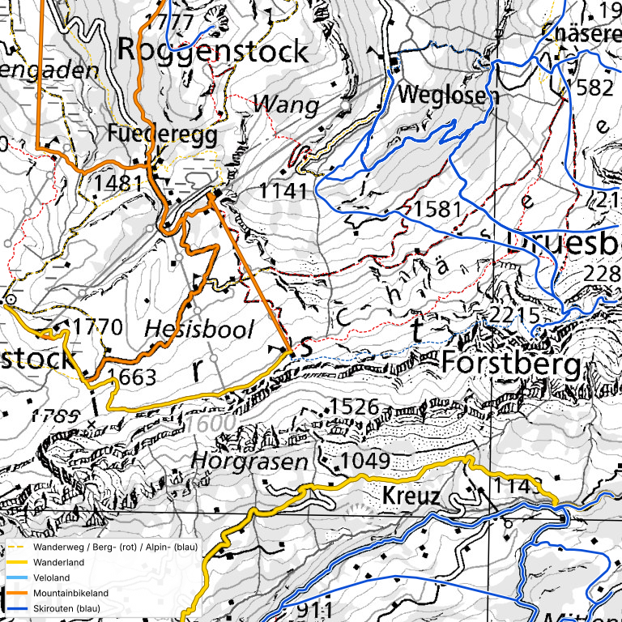

# swisstopo → Garmin: SwissTOPO Vector, Höhenlinien und Routen-Overlays

Dieses Repo baut aus offenen Bundesdaten Vektorkarten für Garmin-Geräte (`.img`):

- **SwissTOPO Vector Edge / Fenix** (`swisstopo_vector_edge_schweiz.img`, `swisstopo_vector_fenix_schweiz.img`): die Basiskarten der ganzen Schweiz aus swissTLM3D, zwei Varianten (Edge mit mehr Namen, Grenzen und Schildern; Fenix reduziert).
- **Höhenlinien** (10 m) und **Routen-Overlays** (Wanderwege, Wanderland, Veloland, Mountainbikeland, Skirouten): je eine **eigene Karte** mit eigener Family-ID, die auf eine Basiskarte gelegt wird (SwissTOPO Vector, die Garmin-Karte oder OpenTopoMap).

**Teststand:**
- **Garmin Edge 1040: geprüft, funktioniert.** Der Nutzer hat Overlays für Skirouten, Wanderwege und Fahrradrouten aufs Gerät geladen. Mehrere `.img`-Dateien nebeneinander werden also geladen. Welche der beiden Fahrradkarten (Veloland, Mountainbike) einzeln geprüft wurde, ist nicht festgehalten.
- **Garmin Fenix 5S Plus: Test offen.** Ob die Uhr mehrere `.img` nebeneinander lädt und wie die Linien auf dem kleinen Display aussehen, ist ungeprüft.

Die Overlays:

| Datei | Inhalt | Darstellung |
|---|---|---|
| `swisstopo_overlay_wanderwege.img` | Wanderwegnetz der Schweiz (swissTLM3D, Stand 2026-07) | schwarz, nicht farbig codiert; Linienart nach Wegtyp wie in der swisstopo-Zeichenerklärung (2-m-Weg durchgezogen, 1-m-Weg gestrichelt, markierte Spur punktiert) |
| `swisstopo_overlay_wanderland.img` | Wanderland-Routen (SchweizMobil) | gelb |
| `swisstopo_overlay_veloland.img` | Veloland-Routen (SchweizMobil) | hellblau |
| `swisstopo_overlay_mountainbike.img` | Mountainbikeland-Routen (SchweizMobil) | orange |
| `swisstopo_overlay_skirouten_blau.img` | Skirouten (swisstopo/SAC u. a.) | blau, durchgezogen, weisser Rand (wie auf der Rasterkarte) |
| `swisstopo_overlay_skirouten_schwierigkeit.img` | gleiche Skirouten | gestrichelt, nach SAC-Schwierigkeit: grün L, blau WS, orange ZS, rot S, violett unbekannt |
| `swisstopo_overlay_hoehenlinien.img` | Höhenlinien, Äquidistanz 10 m (swissALTI3D 2 m) | braun; 50 m und 100 m stärker, mit Höhenangabe |

Die Routen von SchweizMobil tragen «Nummer Name» als Beschriftung (z. B. «1 Via Alpina»), die Skirouten «Name Schwierigkeit». Bei Wanderland, Veloland und Mountainbikeland sind die Linien nach national (breit), regional und lokal gestuft.

Fertige Dateien liegen im Ordner `karten/` (siehe unten).



*Vorschau: eigene Zeichnung mit denselben Farben über einer grauen Landeskarte, kein Rendering vom Gerät.*

## Fertige Karten (`karten/`)

| Ordner | Inhalt | Grösse |
|---|---|---|
| `karten/overlay_hoehenlinien_schweiz/` | Höhenlinien 10 m, ganze Schweiz, in 2 Teilen (zusammensetzen mit `cat`, siehe README im Ordner) | 167 MB |
| `karten/swisstopo_vector_edge_schweiz/` | **SwissTOPO Vector Edge**, ganze Schweiz, in 3 Teilen (zusammensetzen mit `cat`, siehe README im Ordner) | 272 MB |
| `karten/swisstopo_vector_fenix_schweiz/` | **SwissTOPO Vector Fenix**, ganze Schweiz, in 3 Teilen | 267 MB |
| `karten/overlays_schweiz/` | alle 6 Overlays, ganze Schweiz | 14 MB |
| `karten/overlays_oberiberg_test/` | alle 6 Overlays, Testausschnitt Oberiberg SZ (ca. 40 × 40 km) plus `vorschau.png` | 0,8 MB |

Installation: gewünschte `.img` nach `Garmin/` auf das Gerät kopieren (USB), neu starten, unter Einstellungen → Karte aktivieren. Eine vorhandene `gmapsupp.img` nicht überschreiben.

## Datenquellen

Alle Daten sind offen auf `data.geo.admin.ch` verfügbar (STAC-Collection in Klammern). Die Lizenz steht dort als «proprietary»; die Nutzungsbedingungen von swisstopo bzw. ASTRA/SchweizMobil gelten. Repo daher nicht öffentlich machen, ohne sie geprüft zu haben.

| Ebene | Datensatz | Stand |
|---|---|---|
| Wanderwege | swissTLM3D Wanderwege, Layer `tlm_strassen_strasse` mit Feld `wanderwege` (`ch.swisstopo.swisstlm3d-wanderwege`), 409'276 Abschnitte | 2026-07 |
| Wanderland, Veloland, Mountainbikeland | SchweizMobil, Layer `Route` (`ch.astra.wanderland`, `ch.astra.veloland`, `ch.astra.mountainbikeland`) | 2026-02 |
| Skirouten | `ch.swisstopo-karto.skitouren`, 10'789 Routen: swisstopo/SAC 9'384, Petzl Foundation/Skitourenguru 884, DAV/ÖAV/AVS 439, topo.verlag 82 (Feld `source`) | 2025-12 |
| SwissTOPO Vector | swissTLM3D (`ch.swisstopo.swisstlm3d`), Ausgabe 2026-02 | 2026-02 |
| Höhenlinien | swissALTI3D (`ch.swisstopo.swissalti3d`), 2-m-Raster, neuestes Jahr je 1-km-Kachel | 2019–2026 |

## Aufbau des Repos

```
README.md                      diese Datei
AGENTS.md                      Kontext für KI-Assistenten (Ziel, Entscheide, Stand)
scripts/                       alle Skripte
  download_daten.sh              lädt die Overlay-Datensätze von data.geo.admin.ch
  build_overlays.sh              baut die 6 Overlay-.img (Hauptskript, siehe unten)
  routes2mkgmap.py                  GeoPackage → OSM-XML für die Routen-Overlays
  make_overlay_typ.py            schreibt die TYP-Dateien (Farben, Breiten, Muster)
  mkgmap_xml_writer.py                  gemeinsame OSM-XML-Ausgabe
  build_hoehenlinien.sh          baut das Höhenlinien-Overlay (10 m) aus swissALTI3D
  hoehenlinien2mkgmap.py            swissALTI3D-Kacheln → Höhenlinien als OSM-XML
  swissalti3d_kachelliste.py     listet alle swissALTI3D-Kacheln (neuestes Jahr)
  build_vector.sh                baut SwissTOPO Vector (ganze Schweiz oder Region)
  vector2mkgmap.py                  swissTLM3D-Shapefiles → OSM-XML, inkl. abgeleitetem Siedlungsgebiet
  make_vector_typ.py             schreibt die TYP-Datei (Farben, Muster, Linien)
  vector_palette.py              Farben von SwissTOPO Vector (aus Edge-1040-Bildschirmfotos)
  preview_vector.py              Vorschau-Zeichnung von SwissTOPO Vector
mkgmap/
  overlays/style/                mkgmap-Regeln: Tags → Garmin-Linientypen
  overlays/typ/                  erzeugte TYP-Dateien, eine je Overlay
  vector/style/, typ/            dasselbe für SwissTOPO Vector
karten/                        fertige Karten
experimente/                   Einzelversuche, nicht Teil der Pipeline
```

## Eigene Karten bauen

### Voraussetzungen
- Python 3 mit `pyogrio shapely pyproj numpy` (für die Vorschau zusätzlich `geopandas matplotlib`), z. B. `python3 -m venv venv && venv/bin/pip install pyogrio shapely pyproj numpy geopandas matplotlib`
- Java (getestet mit 21) und **mkgmap** (getestet r4924): <https://www.mkgmap.org.uk/download/mkgmap.html>
- Rund 1 GB Festplatte für die Daten, 15 GB RAM sind komfortabel (die Schweiz wird in 4 Kacheln gebaut)
- Internetzugang zu `data.geo.admin.ch`

### Schritte
```
scripts/download_daten.sh daten/                       # einmalig, ca. 750 MB
scripts/build_overlays.sh daten/ mkgmap/mkgmap.jar out/                      # ganze Schweiz
scripts/build_overlays.sh daten/ mkgmap/mkgmap.jar out/ 8.50 46.85 9.05 47.21   # nur eine Region (W S E N)
```
Ergebnis: `out/swisstopo_overlay_*.img`. Die ganze Schweiz braucht einige Minuten. Bereits berechnete Zwischenstände (`out/osm/`) werden wiederverwendet; zum Neuberechnen löschen.

### Was `build_overlays.sh` tut
Das Skript baut aus den GeoPackages die sechs `.img`-Dateien:

1. **Kacheln festlegen.** Mit Bounding Box eine Kachel, sonst die Schweiz in 2 × 2 Kacheln, damit der Speicher reicht.
2. **Konvertieren** (`routes2mkgmap.py`). Liest je Ebene das GeoPackage, schneidet die Linien auf die Kachel zu, vereinfacht sie (2 m) und schreibt OSM-XML mit den Tags `route_layer` (wanderwege, wanderland, veloland, mtb, ski), `route_class` (z. B. national/regional/lokal, Wanderweg/Berg/Alpin, SAC-Klasse 1–4) und `name`. Hin- und Rückweg identischer SchweizMobil-Routen werden nur einmal geschrieben.
3. **TYP-Dateien schreiben** (`make_overlay_typ.py`). Pro Overlay eine TYP-Datei mit eigener Family-ID: Farben, Linienbreiten, Strichmuster.
4. **mkgmap aufrufen**, einmal je Overlay. mkgmap liest die OSM-Dateien, ordnet über `mkgmap/overlays/style/lines` jedem Tag-Satz einen Garmin-Linientyp zu und verpackt alles mit der TYP-Datei in eine `gmapsupp.img`. Der Name im Gerätemenü kommt aus `--description`.
5. **Umbenennen** nach `swisstopo_overlay_<name>.img` im Ausgabeordner.

| Overlay | Family-ID | Mapname |
|---|---|---|
| Wanderwege | 3911 | 63911001 |
| Wanderland | 3912 | 63912001 |
| Veloland | 3913 | 63913001 |
| Mountainbikeland | 3914 | 63914001 |
| Skirouten blau | 3915 | 63915001 |
| Skirouten nach Schwierigkeit | 3916 | 63916001 |

### Aussehen anpassen
- **Farben, Breiten, Strichmuster:** `scripts/make_overlay_typ.py` (Konstanten oben: `YELLOW`, `LBLUE`, `ORANGE`, `SKI_BLUE`, Breiten je Kategorie). Danach `build_overlays.sh` neu starten; die OSM-Zwischendateien werden wiederverwendet.
- **Zuordnung Kategorie → Linientyp:** `mkgmap/overlays/style/lines`.
- **Ab welchem Zoom sichtbar:** `resolution`-Werte in `mkgmap/overlays/style/lines` (höher = erst bei stärkerer Vergrösserung).

### Technische Fallstricke (mkgmap)
- `--style-file` zeigt direkt auf das Style-Verzeichnis. Mit zusätzlichem `--style=.` nutzt mkgmap still den Standard-Style und ignoriert die eigenen Tags.
- Erweiterte Linientypen: Code `0x10f00`–`0x10f1f` (Subtyp höchstens `0x1f`), Skirouten `0x11000`–`0x11004`.
- Die TYP-Compiler-Fehler sind stumm (nur `MapFailedExceptions: 1`). Muster-Linien brauchen Breite 32 (`Xpm="32 H N 1"`), und die durchsichtige Farbe (`none`) muss in der Farbtabelle **zuerst** stehen.
- `--mapname` hat 8 Ziffern und muss je Overlay eindeutig sein.
- Polygone erscheinen nur, wenn sie im TYP unter `[_drawOrder]` stehen (relevant für SwissTOPO Vector).

## Höhenlinien-Overlay (`swisstopo_overlay_hoehenlinien.img`)
`scripts/build_hoehenlinien.sh` berechnet aus swissALTI3D (2 m Raster) Höhenlinien mit **10 m Äquidistanz** für die ganze Schweiz (167 MB, Family-ID 3917). Jede 50 m eine Zwischenlinie, jede 100 m eine Hauptlinie, beide mit Höhenangabe. Es ist ein Overlay: es lässt sich über die Basiskarte und die Routen-Overlays legen. Auf keinem Gerät geprüft.
```
scripts/swissalti3d_kachelliste.py tiles_2m.json                  # einmalig, 15–20 Minuten
scripts/build_hoehenlinien.sh tiles_2m.json mkgmap.jar out/                     # ganze Schweiz
scripts/build_hoehenlinien.sh tiles_2m.json mkgmap.jar out/ 8.24 47.44 8.38 47.51   # Region
```
Ablauf: 20-km-Blöcke im LV95-Raster → je Block parallel (3 Prozesse) die 1-km-Kacheln laden (ca. 1 MB je Kachel, die ganze Schweiz sind rund 45 GB Download, nichts davon wird gespeichert), mit `contourpy` Linien im Abstand von 10 m berechnen, mit 2,5 m vereinfachen, als OSM-XML schreiben, mit mkgmap zur Block-Karte bauen, am Ende alle Blöcke und die TYP-Datei zusammenführen. Dauer für die ganze Schweiz: etwa 40 Minuten. Fortsetzbar. Die Linien liegen im Typ `0x20` (10 m), `0x21` (50 m), `0x22` (100 m); Farben und Breiten stehen in `scripts/make_overlay_typ.py`, Sichtbarkeit je Zoom in `mkgmap/overlays/style/lines`.

## SwissTOPO Vector, zwei Varianten (Family-ID 3900 und 3901)
Vektorkarten der ganzen Schweiz aus swissTLM3D (Stand 2026-02), je eine Datei in drei Teilen wegen der GitHub-Grenze von 100 MB. Die Darstellung ist an Bildschirmfotos der Garmin-Vektorkarte auf dem Edge 1040 gemessen; die Flächenmuster für Fels und Reben sind aus diesen Fotos ausgelesen (`scripts/extract_pattern.py`, persönlicher Gebrauch, das Repo ist privat). **Auf keinem Gerät geprüft** (der Nutzer hat nur eine frühere Fassung auf dem Edge 1040 gesehen, sie lud).

| | **SwissTOPO Vector Edge** (3900) | **SwissTOPO Vector Fenix** (3901) |
|---|---|---|
| Ordner | `karten/swisstopo_vector_edge_schweiz/` (272 MB) | `karten/swisstopo_vector_fenix_schweiz/` (267 MB) |
| Fels | graue Fläche mit Textur | einfach grau |
| Namen | Orts-, Strassen-, Gewässer-, Flur-, Geländenamen, Berge mit Höhe («Säntis 2502») | nur die Höhe an Gipfeln und Pässen |
| Grenzen (swissBOUNDARIES3D) | Landes-, Kantons-, Gemeindegrenzen, magenta | keine |
| Strassenschilder (ASTRA) | Nationalstrassen N1 … N29 und 56 Hauptstrassennummern | keine |
| Sportplätze, Freizeitflächen | ja (Sportplätze orange) | nein |

Gemeinsam: Einzelbäume, Schutzverbauungen und Treppen (rot gepunktet) nur in der feinsten Zoomstufe; Reben (orange Blitzstriche auf hellgrün); Tunnel als zwei graue Punktreihen an den Rändern (wie auf der Garmin-Karte); Brücken als Strasse mit schwarzem Rand; Wege 2 px in Dunkelgrau `#414041` nach swisstopo-Legende (2-m-Weg durchgezogen, 1-m-Weg gestrichelt, markierte Spur punktiert); Schutzverbauungen braun, 2 px.

| Element | Darstellung |
|---|---|
| Untergrund | creme `#FFFAE6` |
| Siedlungsgebiet | hellgrau `#EEEEEE`, **abgeleitet** aus den Gebäuden (jedes Gebäude 14 m vergrössert, vereinigt, Gruppen unter 8'000 m² verworfen) |
| Gebäude | grau `#8B898B` |
| Wald / Gehölz | grün `#A4D26A` / hellgrünes Punktmuster |
| Gewässer | See hellblau, Bäche und Flüsse `#52BAF6` |
| Strassen | Autobahn orange, Hauptstrasse gelb, übrige weiss mit grauem Rand, Naturstrassen hellgelb |

Haltestellen sind **nicht** in der Basiskarte, sondern ein eigener Layer: `karten/overlays_schweiz/swisstopo_overlay_haltestellen.img` (Family-ID 3918, 28'042 Haltestellen aus swissTLM3D mit Namen und Symbolen für Bus, Bahn, Schiff, übrige Bahnen). Gebaut mit `scripts/build_haltestellen.sh <shp-ordner> mkgmap.jar out/`.

```
# ganze Schweiz, Edge (Grenzen und Schilder brauchen die Zusatzdaten, siehe unten)
VARIANT=edge GRENZEN=<gpkg> ACHSEN=<gdb> HAUPT=<gdb> scripts/build_vector.sh <shp-ordner> mkgmap.jar out/
VARIANT=fenix scripts/build_vector.sh <shp-ordner> mkgmap.jar out/
scripts/build_vector.sh <shp-ordner> mkgmap.jar out/ 8.24 47.44 8.38 47.51   # Region (Datei *_region.img)
scripts/download_vector_zusatz.sh <ordner>    # swissBOUNDARIES3D, ASTRA Nationalstrassenachsen und Hauptstrassennetz
```
Die Shapefiles stammen aus dem swissTLM3D-Download (`swisstlm3d_2026-02_2056_5728.shp.zip`, 3,6 GB, Link im STAC unter `ch.swisstopo.swisstlm3d`) und müssen entpackt im `<shp-ordner>` liegen (`swissTLM3D_TLM_*.shp`).

Ablauf: Kachelliste im LV95-Raster (20 × 20 km, 234 Kacheln) → je Kachel parallel (3 Prozesse) swissTLM3D → OSM-XML (das ist nur das Zwischenformat für mkgmap, keine OpenStreetMap-Daten; es werden keine OSM-Daten verwendet) → mkgmap → Kachel-`.img` → mkgmap fügt alle Kacheln und die TYP-Datei zusammen. Fertige Kacheln werden übersprungen. Dauer je Variante etwa 45 bis 60 Minuten mit 4 Kernen und 15 GB RAM. Ist das Ergebnis über 90 MB, entstehen Teile `*.img.part_aa, _ab, …`.

**Farben und Muster ändern:** `scripts/vector_palette.py` (Farben), `scripts/vector_pattern_tiles.py` und `scripts/vector_patterns.py` (Flächenmuster), `scripts/vector_shields.py` (Strassenschilder), `scripts/make_vector_typ.py [edge|fenix]` (Linien, Punkte, Reihenfolge). Zuordnung Objektart → Typ: `mkgmap/vector/style/`. Zeichnungen zum Vergleich mit der Rasterkarte: `scripts/compare_vector.py`, Ergebnisse in `docs/vergleich/` (eigene Zeichnungen, **kein** Geräte-Rendering).

**Noch nicht umgesetzt:** POIs wie Restaurants, Parkplatzsymbole, Museen (nicht in swisstopo-Daten; als eigene Karte aus OpenStreetMap geplant, braucht Freigabe von `download.geofabrik.de`), Brücken mit Geländer, Galerien, Strassennummern-Schild für Kantonsstrassen, Felsschraffur wie auf der Rasterkarte (nicht als Vektordaten vorhanden).

## Weitere Anleitungen
- [Populäre Trails finden: Strava-Heatmap in Gaia und Route auf den Edge](docs/anleitung_strava_heatmap_gaia.md) (nicht getestet, kein Teil der Pipeline)

## Grenzen
- **Fenix 5S Plus ungeprüft:** Laden mehrerer `.img` gleichzeitig, Lesbarkeit der Linien auf dem kleinen Display, einzelnes Ein-/Ausschalten der Overlays. Auf dem Edge 1040 laufen die Overlays (siehe Teststand).
- SwissTOPO Vector ist auf keinem Gerät geprüft.
- Die Overlays und die Höhenlinien haben keine Basiskarte. Sie ergänzen eine vorhandene Karte, zum Beispiel SwissTOPO Vector.
- Die Skirouten ersetzen weder das Lawinenbulletin noch eine Tourenplanung.
